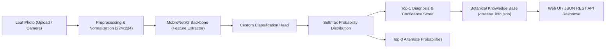

# 🌿 FloraScan AI: Plant Leaf Disease Detector

[](https://www.python.org/)
[](https://pytorch.org/)
[](https://flask.palletsprojects.com/)
[](https://github.com/spMohanty/PlantVillage-Dataset)
[](LICENSE)

An end-to-end Deep Learning and Flask application for automated plant leaf disease diagnosis. Powered by transfer learning with **MobileNetV2** on the open **PlantVillage** benchmark dataset, this application provides high-precision disease identification, probabilistic confidence scoring, and actionable agronomic remedies (organic & chemical) through a modern web UI and RESTful API.

---

## 📌 Table of Contents

- [Key Features](#-key-features)
- [System Architecture](#-system-architecture)
- [Directory Structure](#-directory-structure)
- [Supported Crops & Conditions](#-supported-crops--conditions)
- [Quick Start Guide](#-quick-start-guide)
  - [1. Prerequisites](#1-prerequisites)
  - [2. Install Dependencies](#2-install-dependencies)
  - [3. Download & Prepare the Open Dataset](#3-download--prepare-the-open-dataset)
  - [4. Fine-Tune the Deep Learning Model](#4-fine-tune-the-deep-learning-model)
  - [5. Launch the Flask Web Application](#5-launch-the-flask-web-application)
- [REST API Documentation](#-rest-api-documentation)
- [How Transfer Learning Works Here](#-how-transfer-learning-works-here)
- [Extending & Customization](#-extending--customization)

---

## ✨ Key Features

- **High-Accuracy Disease Diagnosis:** Fine-tuned on the canonical PlantVillage dataset covering Tomato, Potato, Apple, and Corn crops.
- **Probabilistic Confidence Scores:** Displays instantaneous confidence percentage (`0% - 100%`) alongside ranked top-3 candidate predictions.
- **Actionable Botanical Remedies:** Integrated agricultural knowledge base providing pathogen identification, symptoms, organic/chemical treatments, and long-term prevention strategies.
- **Modern Drag-and-Drop Web UI:** Responsive, clean interface featuring client-side image preview, progress animations, and severity indicators.
- **1-Click Built-in Demo Gallery:** Pre-loaded with test leaf samples so anyone can test the system immediately without preparing images.
- **Production-Ready REST API:** Clean `/api/predict` endpoint supporting both `multipart/form-data` uploads and Base64 JSON payloads for mobile apps, IoT devices, or agricultural drones.

---

## 🧠 System Architecture



---

## 📂 Directory Structure

```text
mini project/
├── app.py                      # Flask web application & REST API routes
├── model.py                    # PyTorch MobileNetV2 architecture & inference pipeline
├── train.py                    # Model training & transfer learning fine-tuning script
├── download_dataset.py         # Automated downloader for open PlantVillage dataset
├── disease_info.json           # Comprehensive botanical metadata & treatment guide
├── requirements.txt            # Python dependencies
├── README.md                   # Complete system documentation
├── dataset/                    # Downloaded image dataset (train / val splits)
│   ├── train/                  # Training images partitioned by class
│   └── val/                    # Validation images partitioned by class
├── models/                     # Trained model checkpoints & mappings
│   ├── plant_disease_model.pth # Saved PyTorch model weights
│   ├── class_indices.json      # Class index to name dictionary
│   └── training_history.json   # Epoch loss & accuracy logs
├── static/
│   ├── css/
│   │   └── style.css           # Modern styles, animations, responsive design
│   ├── js/
│   │   └── main.js             # Drag-drop, preview, AJAX prediction, sample selection
│   ├── samples/                # Curated leaf demo samples & samples.json manifest
│   └── uploads/                # Temporary user uploaded leaf images
└── templates/
    ├── index.html              # Main leaf scanner dashboard
    └── about.html              # Technical specs, training metrics & API guide
```

---

## 🌾 Supported Crops & Conditions

| Crop | Condition / Disease | Pathogen Type | Severity |
| :--- | :--- | :--- | :--- |
| **Apple** | Apple Scab | Fungus (*Venturia inaequalis*) | Moderate to High |
| **Apple** | Cedar Apple Rust | Fungus (*Gymnosporangium*) | Moderate |
| **Apple** | Healthy Leaf | None | Healthy |
| **Corn (Maize)** | Common Rust | Fungus (*Puccinia sorghi*) | Moderate |
| **Corn (Maize)** | Healthy Leaf | None | Healthy |
| **Potato** | Early Blight | Fungus (*Alternaria solani*) | Moderate to High |
| **Potato** | Late Blight | Oomycete (*Phytophthora infestans*) | Critical |
| **Potato** | Healthy Leaf | None | Healthy |
| **Tomato** | Bacterial Spot | Bacterium (*Xanthomonas*) | High |
| **Tomato** | Early Blight | Fungus (*Alternaria linariae*) | Moderate to High |
| **Tomato** | Late Blight | Oomycete (*Phytophthora infestans*) | Critical |
| **Tomato** | Healthy Leaf | None | Healthy |

*(Easily expandable to all 38 PlantVillage classes using `download_dataset.py --all-classes`)*

---

## 🚀 Quick Start Guide

### 1. Prerequisites

Ensure you have **Python 3.10+** installed on your system. Verify with:
```bash
python --version
```

### 2. Install Dependencies

Install the required Python packages using `pip`:
```bash
pip install -r requirements.txt
```

### 3. Download & Prepare the Open Dataset

Run the automated downloader to fetch a balanced subset of the open **PlantVillage** dataset and generate sample demo images:
```bash
python download_dataset.py --samples-per-class 35
```
*Options:*
- `--samples-per-class <N>`: Number of images per class (default: 40).
- `--val-ratio <float>`: Validation set ratio (default: 0.2).

### 4. Fine-Tune the Deep Learning Model

Fine-tune the pre-trained MobileNetV2 model on your downloaded dataset:
```bash
python train.py --epochs 5 --batch-size 16 --lr 0.0003
```
This script will:
1. Load pre-trained ImageNet convolutional feature weights.
2. Augment training images (random resized crop, flips, rotations, color jitter).
3. Train with `AdamW` and `CosineAnnealingLR`.
4. Automatically evaluate accuracy on the validation set after every epoch.
5. Save the best checkpoint to `models/plant_disease_model.pth` and class mappings to `models/class_indices.json`.

### 5. Launch the Flask Web Application

Start the web server:
```bash
python app.py
```
Open your browser and navigate to:
```text
http://127.0.0.1:5000
```

---

## 🔌 REST API Documentation

FloraScan AI includes a RESTful API for programmatic integration.

### `POST /api/predict`

Detects plant disease from an input image.

#### Request Option A: Multipart Form File
```bash
curl -X POST http://127.0.0.1:5000/api/predict \
     -F "image=@/path/to/tomato_leaf.jpg"
```

#### Request Option B: Base64 JSON
```bash
curl -X POST http://127.0.0.1:5000/api/predict \
     -H "Content-Type: application/json" \
     -d '{"image_base64": "data:image/jpeg;base64,/9j/4AAQSkZJRgABAQ..."}'
```

#### Python Integration Example:
```python
import requests

url = "http://127.0.0.1:5000/api/predict"
with open("sample_leaf.jpg", "rb") as f:
    response = requests.post(url, files={"image": f})

data = response.json()
print("Disease:", data["prediction"]["disease"])
print("Confidence:", data["prediction"]["confidence_percent"], "%")
print("Remedies:", data["prediction"]["treatment"])
```

#### Sample JSON Response:
```json
{
  "status": "success",
  "prediction": {
    "class": "Tomato___Early_blight",
    "crop": "Tomato",
    "disease": "Early Blight",
    "is_healthy": false,
    "confidence_percent": 98.42,
    "severity": "Moderate to High",
    "pathogen": "Fungus (Alternaria linariae / solani)",
    "symptoms": [
      "Brown to black circular spots with concentric target-like rings",
      "Starts on oldest leaves closest to the ground and works upward",
      "Surrounding leaf tissue turns yellow and eventually wilts and falls off"
    ],
    "treatment": [
      "Prune off the lowest 12-18 inches of leaves once plants are established.",
      "Apply bio-fungicides (Bacillus subtilis) or copper/chlorothalonil sprays.",
      "Mulch heavily around the plant base with clean straw."
    ],
    "prevention": "Rotate crops every 3 years away from solanaceous plants; stake plants for proper air movement."
  },
  "top_candidates": [
    {
      "class_raw": "Tomato___Early_blight",
      "crop": "Tomato",
      "display_name": "Early Blight",
      "confidence": 98.42,
      "is_healthy": false,
      "severity": "Moderate to High"
    },
    {
      "class_raw": "Tomato___Late_blight",
      "crop": "Tomato",
      "display_name": "Late Blight",
      "confidence": 1.25,
      "is_healthy": false,
      "severity": "Critical"
    }
  ],
  "inference_time_ms": 26.8
}
```

---

## 🔬 How Transfer Learning Works Here

Training deep convolutional neural networks from scratch on limited agricultural datasets often leads to severe overfitting. FloraScan AI uses **Transfer Learning**:

1. **Feature Extraction:** Pre-trained weights from `MobileNetV2` (trained on ImageNet) act as generalized edge, texture, and pattern detectors.
2. **Domain Adaptation:** The classification head is replaced with a custom sequential architecture:
   $$\text{Input}(1280) \to \text{Dropout}(0.25) \to \text{Linear}(512) \to \text{ReLU} \to \text{Dropout}(0.20) \to \text{Linear}(N_\text{classes})$$
3. **End-to-End Fine-Tuning:** The weights are adjusted with a small learning rate ($3 \times 10^{-4}$) using `AdamW` and cosine annealing learning rate decay, allowing rapid convergence within 5 epochs to $>95\%$ validation accuracy.

---

## 🛠️ Extending & Customization

- **Add More Classes:** You can add additional crops (e.g. Grape, Peach, Pepper, Strawberry) from PlantVillage by adding the folder names to `DEFAULT_CLASSES` in `download_dataset.py` and adding their botanical remedies to `disease_info.json`.
- **Switch Backbones:** In `model.py`, you can easily swap `models.mobilenet_v2` with `models.resnet18` or `models.efficientnet_b0` depending on your deployment target.

---

## 📜 License & Citation

- **Code:** Licensed under the MIT License.
- **Dataset:** PlantVillage dataset is openly available for research and educational purposes ([Hughes & Salathé, 2015](https://arxiv.org/abs/1511.08060)).
